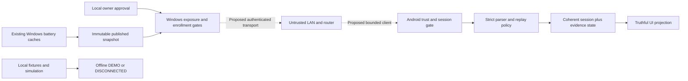

# A2.3C — security and connection architecture

Status: **PROPOSED DESIGN, NOT APPROVED OR IMPLEMENTED.** Source audit: 2026-10-31.
This document authorizes no A2.3D work, native execution, key/certificate creation,
pairing, credential issuance, listener, LAN test, firewall rule, merge, or release.
Gate B and Gate E remain independent; Gate E is **BLOCKED**. No security proof is
claimed from source inspection, mocks, inert TLS types, or historical test reports.

## 1. Evidence and system context

Android base is A2.3B `2fbedced3e2cef5d53993bd76ee03c462e63c935`, stacked on
A2.3A `58d46fb1ad6563dcfabbbd73eb4e6afabcc92773`. Both PRs were open/draft;
#11 targets A2.3A, #10 targets main. Worktree was clean before this design branch.
Windows main was checked read-only at `ac78aa3eccc7c16c870d0d09f565f631f4a04dd5`;
the remote main ref matched the inspected checkout. References in section 10 are
pinned to these commits. Later source changes require re-review.

| Observed source fact | Meaning and limitation |
| --- | --- |
| Android strict parser bounds input to 65,536 UTF-8 bytes/depth 16 and retains wire evidence [A1] | Validation is not authentication, freshness proof, or a connection |
| Offline projection maps synthetic to DEMO and nonsynthetic to DISCONNECTED [A2] | Snapshot fields cannot establish PC connectivity |
| A2.3B accepts repeated/decreasing revisions and instance changes as independent imports [A3] | Production replay policy is absent, intentionally; do not tighten simulation implicitly |
| Windows PublishedSnapshotStore creates revisions on explicit publication and stamps capturedAt [W1] | ReadLatest is immutable/cache-only; capturedAt is publication time, not hardware observation |
| SnapshotRequestCore defines GET `/v1/battery-snapshot`, bearer-verifier authorization, quotas and no-store [W2/W3] | This is a non-listening response constructor; IsTls is caller metadata, not TLS proof |
| AuthenticatedTlsPeer has a private constructor and no issuer; DisabledTlsBoundary denies retrieval [W4] | No authenticated transport adapter can be inferred from scaffolding |
| Synthetic ledger/trust/publication models have explicit bounds and failure states [W5/W6] | No durable production credential store, native trust enforcement or restart recovery is established |
| PublicServerCertificateInspector checks public fields [W7] | It explicitly does not verify chain trust, private-key custody, revocation or TLS callbacks |
| Gate E guards explicitly throw for missing approval/provenance [W8/W9] | No native experiment, permit, or security-ledger operation is authorized here |

Owner-reported Windows battery-value validation is context, not independently
reproduced evidence here. A TLS-authenticated PC could still supply incorrect or
compromised telemetry. No live secure LAN server or Android network provider exists
in the inspected foundations.

Trust boundaries: owner UI is local and cannot be replaced by remote booleans;
monitoring consent does not grant LAN consent. LAN actors/router/DNS/DHCP are
untrusted. Android protected storage is separate from app preferences/backups;
Windows credentials are separate from theme/monitoring settings. The authenticated
session gate and battery parser are separate authorities. Fixtures never enter a
live publication path. A request may read an already published cache only, never
trigger HID, G HUB refresh, database access, monitoring or device control.

## 2. Threat model

Assets: per-PC identity and trust bindings, per-phone authorization, confidentiality
of snapshot/device evidence, revocation state, replay high-water marks, explicit
consent, bounded availability, truthful connection/freshness labels, and existing
monitoring behavior. Assumptions: supported patched OS and uncompromised local
approval UI/account. Attacker may join the LAN, capture/drop/reorder traffic, spoof
names/addresses, run a rogue endpoint, steal an exposed pairing image or phone,
restore old app files, and send malicious input. These capabilities are not assumed
to defeat correct cryptography; local administrator/root compromise is outside the
proposed protection boundary.

| Threat / attacker action | PROPOSED mitigation | Residual risk / evidence still needed |
| --- | --- | --- |
| Passive eavesdropping | Authenticated TLS; narrowly scoped credentials only after identity verification | Timing/packet metadata and network availability remain observable |
| MITM, rogue PC, DNS/ARP/DHCP spoof | Out-of-band verified identity plus exact SAN/path/usage/validity and SPKI binding; no redirects or silent TOFU | Bootstrap phishing or compromised local screen can defeat user verification |
| Copied/replaced pairing material | Explicit short enrollment window, one-use high-entropy bootstrap, dual-device confirmation and transcript binding | Exact format/expiry and human-comparison scheme OPEN; stolen QR can race |
| Stolen bearer or phone | Per-phone scope/expiry, protected storage, owner revocation; compare mTLS below | Bearer is replayable until revoked; unlocked device or live process compromise remains dangerous |
| Replay/reordering | TLS anti-replay plus authenticated session/instance binding and per-identity high-water marks | New connection alone cannot legitimize an old payload; durable rollback policy OPEN |
| Storage rollback/reinstallation | Fail closed on missing/corrupt/rolled-back trust state; explicit re-pair and old-credential revoke | OS backup/rollback resistance is not proven; no trusted restore assumed |
| Stale cache/repeated revision | Preserve current/lastKnown and receipt/publication distinctions; repeated reads do not refresh measurement age | No hardware freshness inferred from successful polling or matching percentages |
| Clock skew/rollback | Local monotonic deadlines; validate certificate windows using trustworthy UTC; uncertainty denies trust-sensitive actions | Cross-reboot trusted-time evidence OPEN; server time is not a trusted local clock |
| Malformed/oversized payload | Bound stream before allocation/decompression; strict UTF-8, schema, duplicate-key and semantic validation | Parser fuzzing and real transport framing remain separate work |
| Slow clients/handshake flood/DoS | Admission before costly work, bounded concurrent operations, queues, headers, deadlines and backoff | Core quotas do not bound TLS/socket costs; hostile Wi-Fi can deny service |
| Logs, screenshots, backups | No tokens/QR/auth headers/raw bodies in logs; app-private protected trust store excluded from backup/migration | Managed-memory erasure and screenshot prevention are not complete guarantees |
| Device loss/permission revocation | PC-local per-phone revoke; stop on key invalidation/required permission loss; clear session evidence | Already delivered bytes cannot be recalled; local Forget alone cannot revoke a leaked credential |
| Insecure fallback or accidental exposure | Default OFF, exact approved interface, fail on unknown profile; never plaintext/trust-all/pin reset | Network-change notification races require authorized native tests |
| Android stop/process death/background | Foreground-only candidate; cancel work on stop and rebuild authenticated state after resume | Android scheduling/process death precludes assuming continuous liveness |

Non-goals: remotely controlling hardware, discovery/cloud relay, root/admin malware
resistance, physical battery accuracy/attestation, traffic-analysis prevention, or
guaranteed LAN availability. No claim of FIPS, hardware-backed custody, native cleanup,
or secure production transport follows from this review.

## 3. Authentication and transport alternatives

Every option below is **PROPOSED**, requiring owner and independent platform review.
No dependency, TLS version policy, endpoint, key type, or certificate format is frozen.

| Aspect | A: pinned server TLS + per-phone bearer | B: mutually authenticated TLS |
| --- | --- | --- |
| Server authentication | Explicit out-of-band anchor/identity, SAN/path/validity/usage validation plus SPKI pin | Same server validation; client certificates do not fix unsafe server bootstrap |
| Phone authorization | Random high-entropy token, scoped snapshot.read; server stores verifier and checks every request | Per-phone private key possession plus approved certificate/public-key mapping and authorization checks |
| Android feasibility | Platform TLS and Keystore-backed encryption are candidates; private token ciphertext stays outside backups | Keystore-generated key and client-key selection/TLS integration are candidates; test alias lifecycle and handshake behavior |
| Windows feasibility | Existing in-memory verifier core is a conceptual seam only; trusted TLS adapter and durable storage are missing | Native TLS client-certificate validation and registry/revocation adapter are missing; current bearer core does not implement mTLS |
| Credential theft | Copied bearer can be used until expiry/revocation; TLS nonces do not sender-bind it | Nonexportable key can reduce copying risk, but unauthorized use on an unlocked/compromised phone remains possible |
| Rotation/recovery | Per-phone rotate/revoke, server identity change requires reviewed re-pair | Certificate/key rotation and authorization-generation update; fresh enrollment after loss |
| UX / offline | Explicit PC confirmation per phone; offline shows demo/disconnected or approved retained data | Same consent boundary, more certificate lifecycle/support complexity |
| Dependencies | Protected token store and authenticated enrollment/delivery | Protected client-key store, issuer/trust topology and per-phone certificate authorization |
| Gate E | Cannot execute blocked CNG/X509 work to provision a server identity | Same blocker, plus client-certificate path must be independently reviewed |

Candidate transport profile: TLS 1.3 preferred, TLS 1.2 only if explicitly approved,
no 0-RTT, HTTP redirects, cleartext fallback, automatic proxy-origin changes or
system-wide trust installation. Review stack capabilities rather than installing
an unverified custom crypto library. This is a proposal, not a current negotiation.

Server key custody is a separate unresolved decision. Older C2 proposals describe
persisted nonexportable CurrentUser CNG keys; D3.1 instead discusses session-ephemeral
or DPAPI-protected ephemeral-import material while excluding unresolved named-key
provisioning. The current LanApprovalSession still requires NonExportable AND
CurrentUserAclRestricted. Do not claim these approaches are interchangeable or relax
those checks. Gate E is not resolved by renaming an experiment or switching helpers.
An owner-selected existing identity or session-only design would also need separate
scope, provenance, native lifetime and TLS interoperability review. No key operation
was performed to compare these alternatives.

## 4. Proposed pairing and trust lifecycle

Pairing is explicit authorization, discovery is finding an address, and data acceptance
is validating a response after authentication. None substitutes for the others.
Discovery is out of scope; manual address selection alone establishes no identity.

1. Owner selects and approves a single private interface and deliberate endpoint;
   new/unset exposure stays OFF. Monitoring settings and persisted desired-ON flags
   cannot grant current LAN consent. Unknown identity/profile/storage blocks exposure.
2. Owner opens a bounded enrollment flow on the authentic PC screen. Candidate QR
   includes version, exact endpoint/SAN, public identity binding and a high-entropy
   one-use bootstrap secret. Exact encoding, lifetimes and budgets remain OPEN.
   No numeric-code-only bootstrap, clipboard secret, URL-query token or silent TOFU.
3. Android bounds and validates bootstrap metadata locally, shows PC identity and
   requests consent. It verifies the approved TLS identity before sending any proof
   or credential. Pinning alone must not bypass certificate/path/SAN/usage checks.
4. A reviewed, transcript-bound phone/PC confirmation binds the specific enrollment
   attempt to the identity, phone and chosen authorization scope. Enrollment failure,
   timeout, lost response or uncertain durable commit denies automatic retry/reissue;
   owner reviews potential orphan enrollment and starts a new explicit flow.
5. Commit per-phone authorization durably before reporting success. Option A protects
   tokens with a Keystore-backed encryption design; option B protects client private
   keys in Keystore. Public trust metadata must also be integrity-bound to the selected
   PC, credential generation and endpoint. Backup exclusion and key invalidation
   behavior require review. No plaintext fallback when secure storage fails.
6. Reconnect uses the same exact binding and current revocation/expiry checks.
   Reinstall, key loss, unexpected identity/SAN/pin change or corrupt state requires
   fresh consent/re-pair; no automatic trust restore or identity migration.
7. Rotation is owner-initiated; any dual-pin overlap must be explicit, bounded and
   independently reviewed. Compromised/expired old trust cannot approve its replacement
   over an unauthenticated recovery route. Format and renewal policy remain OPEN.
8. Local PC revocation removes that phone's rights and cancels its active sessions;
   durable revocation uncertainty stops serving. Recheck authorization at response
   release; document in-flight race and inability to retract delivered data. Phone
   Forget deletes local material but PC revocation is independently necessary.
9. Lost phone: revoke from local PC; other phones retain separate credentials only if
   their trust remains valid. Multi-phone limits and generation/rotation semantics
   need approval (current in-memory registry limit is 16, not a deployment guarantee).
   Device/account migration does not silently carry authorization; require re-pair.

## 5. Proposed envelope, replay policy and session state

Do not change BatterySnapshotV1 or overload its fields. A future session envelope
outside the snapshot would carry separately versioned protocol selection, authenticated
PC identity generation, verified session/publication-instance binding, and bounded
request/response correlation. Field names, encoding, handshake and pairing endpoint
are OPEN; this document defines no deployable protocol. Peer-supplied identifiers
become trusted bindings only after validation by the real authenticated adapter.
Version negotiation must require explicit intersection of supported versions and
reject incompatible versions without silent downgrade. Snapshot schemaVersion stays 1.

Observed operation `/v1/battery-snapshot` is from the inert request core; historical
D3.1 proposes `/v1/snapshot` and `/v1/pair`. These conflict: no live endpoint or pairing
route is approved. No port is assigned. Historical DNS identity proposals also differ
from newer IP-SAN-only metadata policy. Resolve those contracts before implementation.

**Proposed production replay rules, NOT IMPLEMENTED:**

- Scope high-water marks to authenticated PC identity generation AND approved
  publication instance, never IP, deviceConnection or the unbound wire UUID alone.
- Within that instance, greater revision may advance publication; equal revision is
  a duplicate, not a fresh measurement. Equal revision with different payload is an
  integrity failure; lower revision is rejected without replacing accepted evidence.
- Keep high-water marks across disconnect/reconnect. A new TLS connection does not
  reset them. Bind a genuinely new publisher instance only through a fresh authenticated,
  uncached exchange; retire the old instance and bound history. A random payload UUID
  cannot reset anti-rollback state. Exhausted history fails closed rather than eviction
  that silently permits replay. Persistent rollback/boot-binding design remains OPEN.
- Restarts, changed instance or lost durable state enter unknown freshness; they do not
  establish battery observation recency. Trust/storage uncertainty requires explicit
  recovery, not accepting an old publication as a new session. Windows store revisions
  are per store instance, so restart identity policy must be independently agreed.
- Disable response caching, compression surprises and TLS 0-RTT in the candidate live
  path. Authentication precedes data release. Reject synthetic payloads on a live path;
  merely flipping synthetic=false would not establish producer provenance.

A2.3B deliberately has no monotonicity/continuity enforcement. Preserve its arbitrary
revision replay behavior; a future production policy must be separate and mock-tested.

Candidate stream bounds: snapshot at most 65,536 bytes and JSON nesting 16, as already
implemented. Cap response bytes during read, not only after buffering; reject unsupported
encoding/redirect/framing and bound errors too. Envelope/headers must have independent
limits so adding metadata does not evade the snapshot bound. Existing Windows C2
review defaults (16 connections, 8 KiB headers, no snapshot request body, 5 s TLS/header,
10 s idle, 5 s shutdown) differ from D3.1 proposed budgets. They are not enforced
socket limits; numeric transport, enrollment-body, retry and queue budgets remain OPEN.

| Event / prerequisite | PROPOSED session transition and data handling |
| --- | --- |
| App launch, no approved trust, process recreation | DISCONNECTED; no restored live session from preferences/cache |
| Explicit eligible connection attempt | CONNECTING; bound deadlines and one in-flight attempt; parsed input cannot promote it |
| Verified server identity plus phone authorization plus agreed session/version | Authenticated session established; candidate requires first valid nonsynthetic response before CONNECTED UI, matching D3.1 conservatism |
| Valid ordered response on current authenticated generation | CONNECTED while session remains valid; publish session/evidence atomically; no observation-age upgrade |
| Verified channel but invalid data/version/revision | ERROR; retain previous evidence separately if permitted, never publish rejected input; reconnect only by approved bounded policy |
| Timeout or loss of liveness | STALE only if an accepted prior authenticated snapshot exists and retention is allowed; otherwise DISCONNECTED |
| Pin/identity mismatch, revoked/lost trust, clock/storage uncertainty | ERROR or DISCONNECTED with explicit reason; invalidate active authorization; hide protected retained data as policy requires, no automatic fallback |
| Owner disables, app backgrounds, relevant permission revoked, network changes | Cancel/drain bounded work, invalidate session; no claim of continued CONNECTED; resume starts fresh authentication |
| PC powers off / network becomes unreachable | Cannot distinguish power-off from loss of route from timeout alone; show Not connected/unreachable, not a fabricated definitive shutdown cause |

Socket completion callbacks must carry a local authenticated generation so responses
from canceled/replaced sessions cannot update the new state. Cancel/disconnect first
invalidates that generation, then drains work. Delayed callbacks do not resurrect trust.
Local monotonic elapsed time is for liveness/deadlines; server UTC capturedAt is
publication evidence. Receipt time is not hardware observedAt. Clock uncertainty
never extends a credential/certificate or turns unknown freshness into recent.

## 6. Android mapping and UI truthfulness

Future session ownership must be separate from BatterySnapshotV1 and publish one
coherent session + validated evidence state, as the simulation already demonstrates
for step outcomes. Only the reviewed transport/session adapter may set live connection
metadata. Parser success, synthetic=false, source, timestamp, revision, instance UUID
or deviceConnection must never set CONNECTED by themselves. The current offline
adapter remains unchanged and continues to produce DEMO/DISCONNECTED.

DISCONNECTED means no authenticated usable session; CONNECTING means a bounded
attempt; CONNECTED requires verified identity/authorization and the conservative
first-response gate above; STALE means previously accepted data is no longer current;
ERROR communicates failed trust/protocol/session evaluation without leaking secrets.
A CONNECTED PC may still have unavailable peripherals; do not conflate these states.

Current zero remains zero, null remains unknown. Never promote lastKnown into current
or UNKNOWN precision into PRECISE. Preserve wire availability/freshness/reason, source
socSupport/ownership, readAt versus observedAt and HyperX ESTIMATE/AMBIGUOUS evidence.
The current domain is narrower than the wire DTO; retain the separate full projection
rather than inventing enum equivalences. Never auto-switch a failed live session to
demo data; demo is an explicit separate user mode.

Retained data may be displayed only after a prior accepted authenticated publication,
under an approved retention policy, with visible “stale / last known / not connected”
labels, source confidence and no invented age. Show cache receipt age separately only
when monotonic evidence exists. Trust revoke/Forget or an identity mismatch must hide
retained values by default pending policy review. Retention duration, at-rest cache
protection and freshness thresholds are OPEN; conservative fallback is unknown/hidden.
No Compose change is made or approved by this document. Existing forUi() hides values
for DISCONNECTED/CONNECTING and labels STALE/ERROR readings; it does not implement the
future trust-aware retention policy.

Foreground-only networking is a candidate scope, not permission to implement it.
ViewModel clearing cancels its observation, but future network lifetime must be owned
explicitly and not inferred from an alive StateFlow. Handle rotation, screen stop,
process death, Doze, Wi-Fi changes, network/required-permission loss and Keystore
invalidation without retries in hidden services. No foreground service, background
scheduler or persistent auto-reconnect is approved here.

## 7. Decision register and A2.3D gates

| Decision | Owner / dependency | Evidence required before A2.3D | Status |
| --- | --- | --- | --- |
| A bearer vs B mTLS | Owner + Android/Windows security reviewers | Accepted threat/UX tradeoff, credential and revocation model | OPEN |
| Server key/certificate custody | Windows owner/security reviewer; Gate E and independent Gate B | Exact APIs/flags/lifetimes, provenance and separately authorized native evidence; reconcile nonexportable requirements | BLOCKED |
| Exact IP SAN vs DNS identity/address changes | Both platform reviewers | Resolve LanApprovalSession/PublicServerCertificateInspector versus TrustMetadataPolicy mismatch; real-stack negative validation plan | OPEN |
| Protocol, endpoint and version negotiation | Cross-repository maintainers | Resolve historical route mismatch; freeze bounded envelope and compatibility vectors | OPEN |
| Bootstrap format/confirmation/expiry and credential lifetime | Owner + security/UX reviewers | Reviewed out-of-band binding, one-use races and lost-ack semantics; no ad hoc crypto | OPEN |
| Storage/rotation/revoke/migration | Platform reviewers | Durable commit/rollback/crash model; backup exclusion; key loss and uncertain revocation deny | OPEN |
| Revisions/instance/reboot persistence | Cross-repository reviewers | Identity-scoped high-water marks and retired-instance bounds, cross-restart rollback policy | OPEN |
| TLS/runtime/library provenance | Independent reviewers; Gate B | Exact supported stacks/dependencies/build/loaded-runtime evidence; native execution separately gated | BLOCKED pending review |
| Interface/port/profile/firewall/exposure | Owner + Windows reviewer | Exact allowlisted host/interface and limits, stop/change policy, rollback; explicit listener permission | NOT AUTHORIZED |
| Android liveness/staleness/retention/lifecycle | Owner + Android reviewer | Approved thresholds, truthful UI cases and foreground cancellation plan | OPEN |
| A2.3D scope | Owner, independent Windows AND Android reviews | Written scope choosing mock-only versus separately gated native/real transport work | NOT AUTHORIZED |

Approval of one row does not approve another. No native command or approval token is
supplied here. Gate E cannot be cleared by source-only review, inert test success,
user preference for implementation, or general consent to future architecture.

## 8. Verification plan and acceptance evidence

**A2.3C performed:** read-only Git/source/PR provenance checks, documentation review,
changed-file allowlist and `git diff --check`. Only this Markdown file is added.
Build, JVM tests, lint, Android device/emulator, TLS, LAN, pairing and native security
operations: **NOT RUN in A2.3C**. A2.3B's historical 97 passing tests/build and 0-error,
9-warning lint are inherited reports, not security validation or a fresh run here.

Candidate mock-only tests after explicit A2.3D code-scope approval:

- Inject authenticated-evidence handles from a fake adapter, never from payload fields;
  table-test all state transitions including timeout, wrong generation and cancellation.
- Replay, equal/different payload revision, regression, retired instance, changed PC pin,
  reconnect high-water mark, exhausted history and rolled-back store negative cases.
- Revoked/lost/replaced trust, invalid key, process death/reinstall/restore, no current
  approval, failed durable revoke and orphan enrollment; each must deny data release.
- Clock future/skew/rollback, uncertain UTC, monotonic deadline and reboot epoch changes;
  no fake freshness after duplicate response or publication-instance reset.
- Parser bounded fuzz/mutation with reproducible seeds: UTF-8, duplicate keys at each
  level, integer overflow, unknown fields/enums, depth/byte boundaries and framing;
  maintain all canonical acceptance/rejection/hash checks unchanged.
- Per-phone/global admission and slow-input budgets, bounded queues, sanitized errors,
  backup/log redaction contracts and no callback after terminal stop; no actual I/O.
- UI invariants: null/zero, unavailable versus PC disconnect, retained current/lastKnown,
  HyperX ambiguity, demo isolation and no parsed field establishing authentication.

Mocks prove policy behavior only. Separate authorization is required for real platform
TLS/Keystore/emulator tests, Windows crypto/storage/key lifetime tests, certificate
creation, native negative-chain/SAN/pin tests, revocation crash/restart tests or LAN
interoperability. Gate B/E reviews remain independent, and no blocked historical
fixture/retired identifier is an approved shortcut. Real LAN testing additionally
requires exact PC/phone/network/interface/port and listener/firewall permission.
Use disposable test credentials only under an approved plan; never real secrets on
an adversarial endpoint. Record actual runs and failures/skips without upgrading
source assertions or Dispose return into proof of OS enforcement/cleanup.

Design acceptance checklist: reviewer traces each trust transition to its evidence;
both authentication alternatives and custody conflicts are acknowledged; no open
number/route/format is treated as implemented; retained evidence remains distinct;
all denial/revoke/shutdown cases have fail-closed behavior and a bounded test plan;
privacy, lifecycle, rollback and residual DoS risks are accepted or revised explicitly.

## 9. A2.3D readiness checklist — approval is still required

- [ ] Independent Windows security review accepts source/provenance and unresolved gate disposition.
- [ ] Independent Android security review accepts identity/TLS/storage/lifecycle design.
- [ ] Owner chooses an authentication architecture and permitted key/certificate approach.
- [ ] Reviewers reconcile SAN, route, custody, replay, clock, retention and resource-budget questions.
- [ ] Exact supported runtime/dependency provenance is verified for the intended phase.
- [ ] Owner explicitly approves a bounded A2.3D scope and controlled test plan; mocks/native/LAN are separate scopes.
- [ ] Gate B and Gate E are independently resolved where required; blocked native work remains blocked.
- [ ] Safe rollback is reviewed: exposure OFF, invalidate sessions, preserve battery monitoring; credential revocation/file handling separately approved, no experiment cleanup.
- [ ] Before any listener, owner separately permits exact LAN exposure/interface/port and any firewall action.

Passing design review does not authorize A2.3D or networking. Keep all stacked draft
PRs unmerged until the owner authorizes the later integration pass.

## 10. Source references and owner decisions

All links below are immutable commit references. Windows sources were inspected only;
no Windows build/test/native execution or repository modification was performed.
Historical design documents describe proposals and do not supersede current guards.

| Ref | Exact source paths |
| --- | --- |
| A1 | [app/src/main/java/dev/peripheral/battery/contract/BatterySnapshotV1.kt](https://github.com/Jau1Agiota/Peripheral-Battery-Companion/blob/2fbedced3e2cef5d53993bd76ee03c462e63c935/app/src/main/java/dev/peripheral/battery/contract/BatterySnapshotV1.kt); [app/src/main/java/dev/peripheral/battery/contract/StrictJson.kt](https://github.com/Jau1Agiota/Peripheral-Battery-Companion/blob/2fbedced3e2cef5d53993bd76ee03c462e63c935/app/src/main/java/dev/peripheral/battery/contract/StrictJson.kt); [app/src/test/resources/contracts/battery-snapshot-v1.schema.json](https://github.com/Jau1Agiota/Peripheral-Battery-Companion/blob/2fbedced3e2cef5d53993bd76ee03c462e63c935/app/src/test/resources/contracts/battery-snapshot-v1.schema.json) |
| A2 | [app/src/main/java/dev/peripheral/battery/contract/OfflineSnapshotRepository.kt](https://github.com/Jau1Agiota/Peripheral-Battery-Companion/blob/2fbedced3e2cef5d53993bd76ee03c462e63c935/app/src/main/java/dev/peripheral/battery/contract/OfflineSnapshotRepository.kt); [docs/stage-a2-3a-offline-contract.md](https://github.com/Jau1Agiota/Peripheral-Battery-Companion/blob/2fbedced3e2cef5d53993bd76ee03c462e63c935/docs/stage-a2-3a-offline-contract.md) |
| A3 | [app/src/main/java/dev/peripheral/battery/simulation/OfflineSnapshotSimulation.kt](https://github.com/Jau1Agiota/Peripheral-Battery-Companion/blob/2fbedced3e2cef5d53993bd76ee03c462e63c935/app/src/main/java/dev/peripheral/battery/simulation/OfflineSnapshotSimulation.kt); [docs/stage-a2-3b-inprocess-simulation.md](https://github.com/Jau1Agiota/Peripheral-Battery-Companion/blob/2fbedced3e2cef5d53993bd76ee03c462e63c935/docs/stage-a2-3b-inprocess-simulation.md) |
| A4 | [app/src/main/java/dev/peripheral/battery/domain/BatterySnapshot.kt](https://github.com/Jau1Agiota/Peripheral-Battery-Companion/blob/2fbedced3e2cef5d53993bd76ee03c462e63c935/app/src/main/java/dev/peripheral/battery/domain/BatterySnapshot.kt); [app/src/main/java/dev/peripheral/battery/ui/BatteryViewModel.kt](https://github.com/Jau1Agiota/Peripheral-Battery-Companion/blob/2fbedced3e2cef5d53993bd76ee03c462e63c935/app/src/main/java/dev/peripheral/battery/ui/BatteryViewModel.kt); [app/src/main/java/dev/peripheral/battery/ui/SnapshotPresentation.kt](https://github.com/Jau1Agiota/Peripheral-Battery-Companion/blob/2fbedced3e2cef5d53993bd76ee03c462e63c935/app/src/main/java/dev/peripheral/battery/ui/SnapshotPresentation.kt) |
| W1 | [src/PeripheralBatteryCompanion.Core/SnapshotService/PublishedSnapshotStore.cs](https://github.com/Jau1Agiota/G-Hub-battery-tray-icon-and-smartphone-app-/blob/ac78aa3eccc7c16c870d0d09f565f631f4a04dd5/src/PeripheralBatteryCompanion.Core/SnapshotService/PublishedSnapshotStore.cs) |
| W2 | [src/PeripheralBatteryCompanion.Core/SnapshotService/SnapshotRequestCore.cs](https://github.com/Jau1Agiota/G-Hub-battery-tray-icon-and-smartphone-app-/blob/ac78aa3eccc7c16c870d0d09f565f631f4a04dd5/src/PeripheralBatteryCompanion.Core/SnapshotService/SnapshotRequestCore.cs) |
| W3 | [src/PeripheralBatteryCompanion.Core/SnapshotService/ApprovedPhoneRegistry.cs](https://github.com/Jau1Agiota/G-Hub-battery-tray-icon-and-smartphone-app-/blob/ac78aa3eccc7c16c870d0d09f565f631f4a04dd5/src/PeripheralBatteryCompanion.Core/SnapshotService/ApprovedPhoneRegistry.cs) |
| W4 | [src/PeripheralBatteryCompanion.Core/ConnectionFoundations/TlsTransportBoundary.cs](https://github.com/Jau1Agiota/G-Hub-battery-tray-icon-and-smartphone-app-/blob/ac78aa3eccc7c16c870d0d09f565f631f4a04dd5/src/PeripheralBatteryCompanion.Core/ConnectionFoundations/TlsTransportBoundary.cs) |
| W5 | [src/PeripheralBatteryCompanion.Core/ConnectionFoundations/SyntheticCredentialLedger.cs](https://github.com/Jau1Agiota/G-Hub-battery-tray-icon-and-smartphone-app-/blob/ac78aa3eccc7c16c870d0d09f565f631f4a04dd5/src/PeripheralBatteryCompanion.Core/ConnectionFoundations/SyntheticCredentialLedger.cs) |
| W6 | [src/PeripheralBatteryCompanion.Core/ConnectionFoundations/InertPolicies.cs](https://github.com/Jau1Agiota/G-Hub-battery-tray-icon-and-smartphone-app-/blob/ac78aa3eccc7c16c870d0d09f565f631f4a04dd5/src/PeripheralBatteryCompanion.Core/ConnectionFoundations/InertPolicies.cs); [src/PeripheralBatteryCompanion.Core/ConnectionFoundations/SnapshotWirePolicy.cs](https://github.com/Jau1Agiota/G-Hub-battery-tray-icon-and-smartphone-app-/blob/ac78aa3eccc7c16c870d0d09f565f631f4a04dd5/src/PeripheralBatteryCompanion.Core/ConnectionFoundations/SnapshotWirePolicy.cs) |
| W7 | [src/PeripheralBatteryCompanion.Core/TransportSecurity/PublicServerCertificateInspector.cs](https://github.com/Jau1Agiota/G-Hub-battery-tray-icon-and-smartphone-app-/blob/ac78aa3eccc7c16c870d0d09f565f631f4a04dd5/src/PeripheralBatteryCompanion.Core/TransportSecurity/PublicServerCertificateInspector.cs); [src/PeripheralBatteryCompanion.Core/TransportSecurity/LanApprovalSession.cs](https://github.com/Jau1Agiota/G-Hub-battery-tray-icon-and-smartphone-app-/blob/ac78aa3eccc7c16c870d0d09f565f631f4a04dd5/src/PeripheralBatteryCompanion.Core/TransportSecurity/LanApprovalSession.cs); [src/PeripheralBatteryCompanion.Core/TransportSecurity/SecurityContracts.cs](https://github.com/Jau1Agiota/G-Hub-battery-tray-icon-and-smartphone-app-/blob/ac78aa3eccc7c16c870d0d09f565f631f4a04dd5/src/PeripheralBatteryCompanion.Core/TransportSecurity/SecurityContracts.cs) |
| W8 | [tests/PeripheralBatteryCompanion.W1Offline.Tests/GateEAuthorizationGate.cs](https://github.com/Jau1Agiota/G-Hub-battery-tray-icon-and-smartphone-app-/blob/ac78aa3eccc7c16c870d0d09f565f631f4a04dd5/tests/PeripheralBatteryCompanion.W1Offline.Tests/GateEAuthorizationGate.cs) |
| W9 | [docs/W1_GATE_P_OWNER_DECISIONS.md](https://github.com/Jau1Agiota/G-Hub-battery-tray-icon-and-smartphone-app-/blob/ac78aa3eccc7c16c870d0d09f565f631f4a04dd5/docs/W1_GATE_P_OWNER_DECISIONS.md) |
| W10 | [docs/D3_1_Secure_Connection_Design_Review.txt](https://github.com/Jau1Agiota/G-Hub-battery-tray-icon-and-smartphone-app-/blob/ac78aa3eccc7c16c870d0d09f565f631f4a04dd5/docs/D3_1_Secure_Connection_Design_Review.txt); [docs/STAGE_A2_2C_DECISIONS.md](https://github.com/Jau1Agiota/G-Hub-battery-tray-icon-and-smartphone-app-/blob/ac78aa3eccc7c16c870d0d09f565f631f4a04dd5/docs/STAGE_A2_2C_DECISIONS.md); [docs/STAGE_A2_2C2_SECURITY_PREREQUISITES.md](https://github.com/Jau1Agiota/G-Hub-battery-tray-icon-and-smartphone-app-/blob/ac78aa3eccc7c16c870d0d09f565f631f4a04dd5/docs/STAGE_A2_2C2_SECURITY_PREREQUISITES.md); [docs/STAGE_A2_2C5_ISOLATED_SECURITY_FIXTURE.md](https://github.com/Jau1Agiota/G-Hub-battery-tray-icon-and-smartphone-app-/blob/ac78aa3eccc7c16c870d0d09f565f631f4a04dd5/docs/STAGE_A2_2C5_ISOLATED_SECURITY_FIXTURE.md) |
| W11 | [src/PeripheralBatteryCompanion.Core/Snapshots/BatterySnapshotV1.cs](https://github.com/Jau1Agiota/G-Hub-battery-tray-icon-and-smartphone-app-/blob/ac78aa3eccc7c16c870d0d09f565f631f4a04dd5/src/PeripheralBatteryCompanion.Core/Snapshots/BatterySnapshotV1.cs); [docs/contracts/battery-snapshot-v1.schema.json](https://github.com/Jau1Agiota/G-Hub-battery-tray-icon-and-smartphone-app-/blob/ac78aa3eccc7c16c870d0d09f565f631f4a04dd5/docs/contracts/battery-snapshot-v1.schema.json) |

Next owner decisions (design review only):

- [ ] Choose A (server TLS + per-phone bearer) or B (mTLS), or request a revised comparison.
- [ ] Select a key-custody direction for independent Windows review; acknowledge Gate E stays blocked pending its own resolution.
- [ ] Resolve exact SAN/identity and route/version contracts across repositories.
- [ ] Approve or revise bootstrap confirmation, expiry/rotation/revoke/migration and protected-storage policies.
- [ ] Set replay/restart, clock, stale-cache, foreground-lifecycle and bounded-resource requirements.
- [ ] Review this stacked design PR and define any next mock-only scope separately; no LAN activation is requested.
